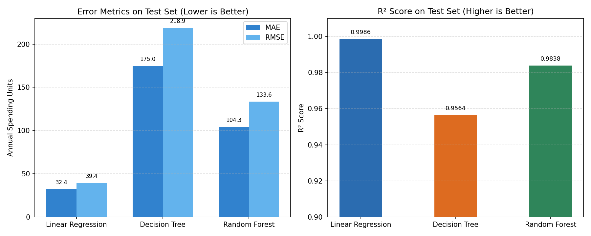
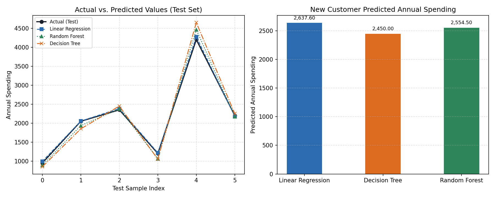

# Customer Annual Spending Prediction

Machine learning regression workflow in Python to predict customer annual spending (`annual_spending`) from demographic and behavioral features (`age`, `monthly_visits`, `avg_order_value`, `months_customer`, `emails_opened`).

## Overview
- **Dataset:** `customer_spending.csv` (30 customer records, 5 predictors, 0 missing values, 0 duplicates).
- **Train / Test Split:** 80% training (24 rows) and 20% testing (6 rows) with `random_state=42` prior to model fitting to avoid data leakage.
- **Models Evaluated:** Linear Regression, Decision Tree Regressor, and Random Forest Regressor.

## Test Set Results
| Model | MAE | MSE | RMSE | R² |
| :--- | :---: | :---: | :---: | :---: |
| **Linear Regression** | **32.39** | **1,554.81** | **39.43** | **0.9986** |
| Random Forest | 104.28 | 17,841.14 | 133.57 | 0.9838 |
| Decision Tree | 175.00 | 47,916.67 | 218.90 | 0.9564 |

## New Customer Prediction
For a customer profile with `age = 40`, `monthly_visits = 12`, `avg_order_value = 80`, `months_customer = 36`, and `emails_opened = 10`:
- **Linear Regression (recommended):** `2,637.60`
- **Random Forest:** `2,554.50`
- **Decision Tree:** `2,450.00`

- ## Visualizations

### Model Comparison (Test Set)

### Actual vs. Predicted & New Customer Prediction

## Files Included
- `customer_spending_prediction.py`: Exploratory checks, train/test split, model training, evaluation, new customer prediction, and chart generation.
- `customer_spending.csv`: Input dataset.
- `model_comparison.png` & `predictions_overview.png`: Evaluation and prediction visualizations.
- `Informe Técnico - Predicción de Gasto Anual.pdf`: Technical summary and methodological notes.

## Note on Sample Size
Because the dataset has 30 records (6 in the test set), evaluation metrics are sensitive to sample size. Re-evaluate with more real customer records and cross-validation as data grows.
